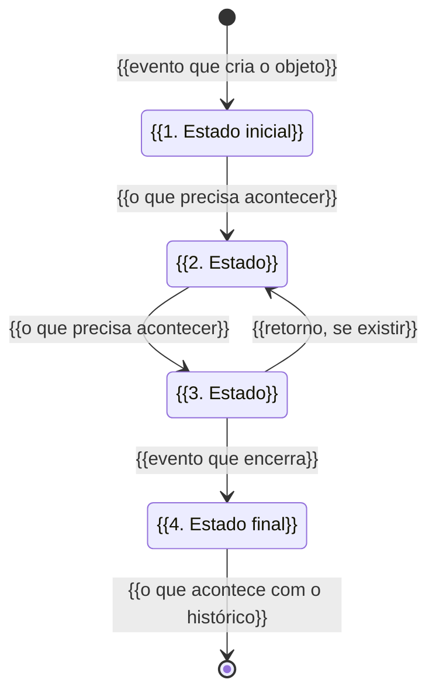
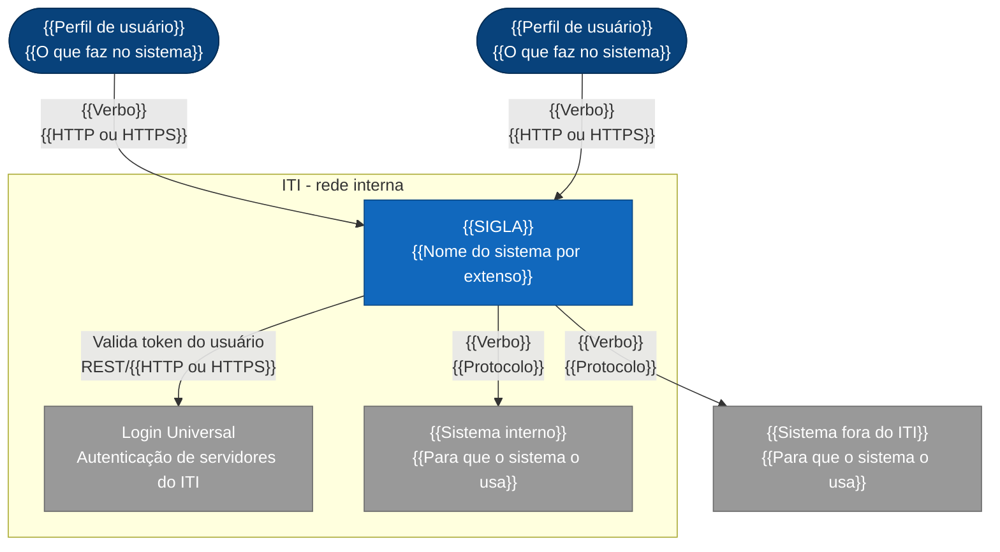
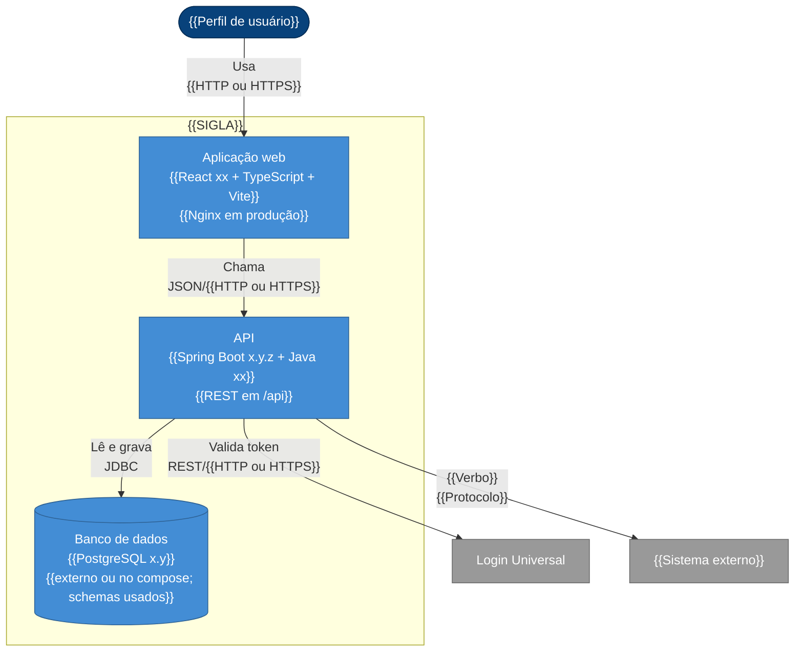
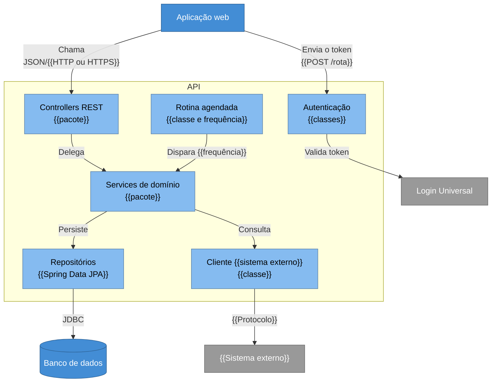
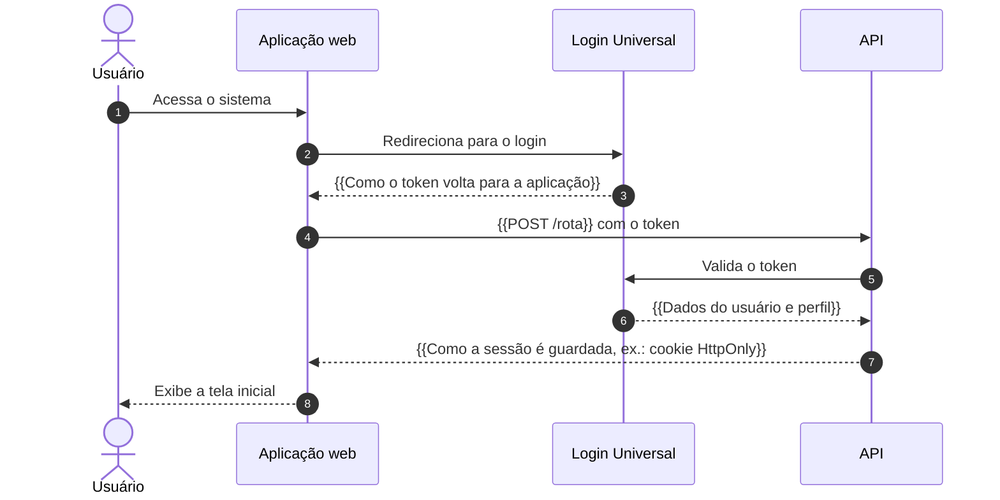
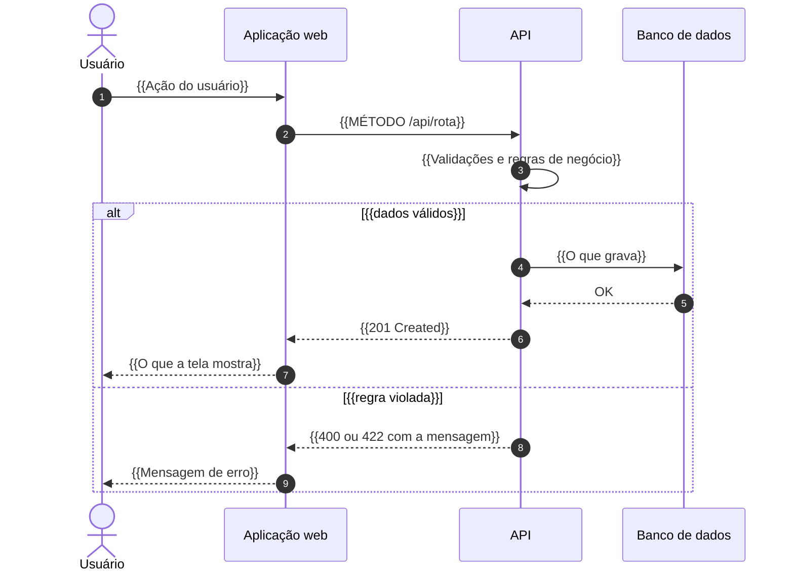
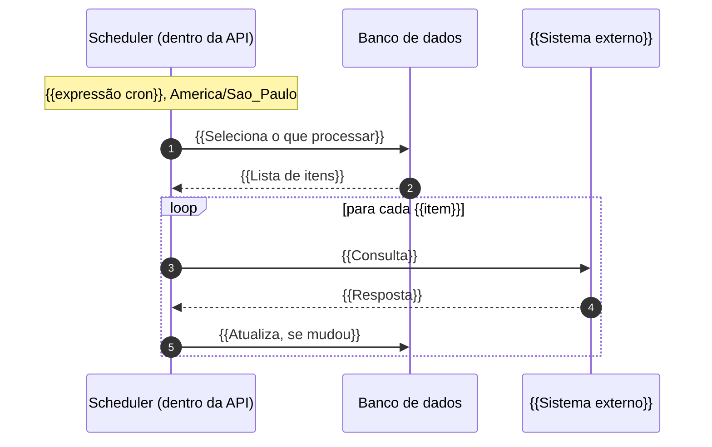
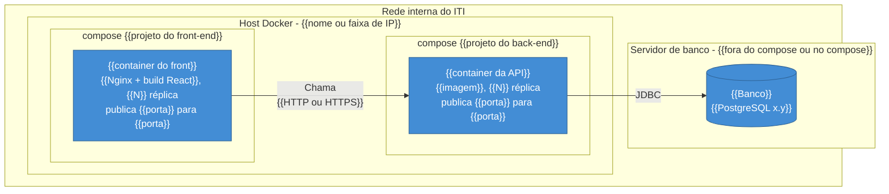

# {{Nome do sistema por extenso}} ({{SIGLA}}): Wiki

> Tudo o que uma pessoa nova no time precisa para entender, alterar e operar o {{Nome do sistema por extenso}} ({{SIGLA}}). Para subir o ambiente local, comece pelo [README](https://git.iti.gov.br/{{grupo}}/{{repositorio}}).

| | |
|---|---|
| **Versão documentada** | {{vX.Y.Z}} |
| **Última revisão** | {{AAAA-MM-DD}} |
| **Responsável técnico** | {{Nome}} ({{nome.sobrenome}}@iti.gov.br) |
| **Dono do produto** | {{Nome}} ({{nome.sobrenome}}@iti.gov.br) |

---

## Sumário

1. [Comece por aqui](#1-comece-por-aqui)
   - [1.1 Trilha de leitura](#11-trilha-de-leitura)
2. [Contexto de negócio](#2-contexto-de-negócio)
   - [2.1 Por que o sistema existe](#21-por-que-o-sistema-existe)
   - [2.2 Base normativa](#22-base-normativa)
   - [2.3 Ciclo de vida do objeto principal](#23-ciclo-de-vida-do-objeto-principal)
3. [Glossário](#3-glossário)
   - [3.1 Termos do sistema](#31-termos-do-sistema)
   - [3.2 Termos gerais da ICP-Brasil e do ITI](#32-termos-gerais-da-icp-brasil-e-do-iti)
4. [Arquitetura (C4)](#4-arquitetura-c4)
   - [4.1 Como ler os diagramas](#41-como-ler-os-diagramas)
   - [4.2 Nível 1: Contexto](#42-nível-1-contexto)
   - [4.3 Nível 2: Containers](#43-nível-2-containers)
   - [4.4 Nível 3: Componentes](#44-nível-3-componentes)
   - [4.5 Fluxos principais](#45-fluxos-principais)
   - [4.6 Implantação](#46-implantação)
5. [Pessoas e responsabilidades](#5-pessoas-e-responsabilidades)

---

## 1. Comece por aqui

### 1.1 Trilha de leitura

Não leia a wiki inteira no primeiro dia. Siga esta ordem; o resto é material de consulta.

<!-- A trilha já vem pronta. Ajuste só o "Por quê" da linha 5 aos fluxos que este sistema documenta. -->

| Ordem | O que ler | Por quê |
|:---:|---|---|
| 1 | [README](https://git.iti.gov.br/{{grupo}}/{{repositorio}}) | Subir o ambiente e ver o sistema funcionando |
| 2 | [Contexto de negócio](#2-contexto-de-negócio) | Entender o problema antes do código |
| 3 | [Glossário](#3-glossário) | Falar a mesma língua do time e da área de negócio |
| 4 | [Arquitetura, níveis 1 a 3](#4-arquitetura-c4) | Ter o mapa mental do sistema |
| 5 | [Fluxos principais](#45-fluxos-principais) | Entender {{os fluxos que mais geram dúvida, ex.: a autenticação e a rotina semanal}} |
| 6 | [Pessoas e responsabilidades](#5-pessoas-e-responsabilidades) | Saber a quem perguntar |

---

## 2. Contexto de negócio

### 2.1 Por que o sistema existe

<!--
  1 parágrafo: dor antes do sistema → o que ele resolve → quem ganha.
  Aprofunda o "Problema que resolve" do README sem copiá-lo: aqui
  entra COMO o trabalho era feito antes (planilha, SEI, e-mail...) e
  o que faltava (visão consolidada, alerta, trilha de alteração...).
-->

{{Parágrafo: como o trabalho era feito antes, o que faltava e o que o sistema passou a garantir.}}

**Área de negócio demandante:** {{Diretoria}}/{{Coordenação}}

**Processos atendidos:** {{lista curta dos processos de negócio}}

**Módulos:**

<!--
  "Nome na tela" exatamente como aparece no menu: é o que a pessoa vai
  procurar ao abrir o sistema.
  Sistema sem telas (API, pipeline, job)? Troque as colunas por
  "Endpoint, DAG ou job", "Nome" e "O que faz".
-->

| Rota | Nome na tela | O que faz |
|---|---|---|
| `{{/rota}}` | {{Nome como aparece no menu}} | {{O que o usuário faz ali}} |
| `{{/rota}}` | {{Nome como aparece no menu}} | {{O que o usuário faz ali}} |

### 2.2 Base normativa

Toda regra de negócio relevante deve ter origem rastreável.

<!--
  "Onde impacta" aponta algo concreto: tela, campo, regra ou rotina.
  "Contexto geral" não ajuda quem vai alterar o código.
  As duas primeiras linhas valem para quase todo sistema do ITI;
  remova se não se aplicarem.
-->

| Normativo | Tema | Onde impacta no sistema |
|---|---|---|
| MP nº 2.200-2/2001 | Institui a ICP-Brasil | {{Tela, regra ou campo}} |
| Lei nº 13.709/2018 (LGPD) | Tratamento de dados pessoais | {{Quais dados pessoais o sistema trata e onde}} |
| {{DOC-ICP-xx ou IN ITI nº xx/AAAA}} | {{Tema}} | {{Tela, regra ou campo}} |

### 2.3 Ciclo de vida do objeto principal

<!--
  Quase todo sistema do ITI gira em torno de um objeto com estados
  (auditoria, pedido de credenciamento, ocorrência, entidade...).
  Desenhe esse ciclo: é o diagrama que mais tira dúvidas.
  - Estados: como a área de negócio os chama ("Em análise", "Encerrada").
  - Setas: o evento que provoca a mudança e, se possível, quem o provoca.
  - Transição definida em normativo? Cite o normativo no rótulo.
  - Inclua os retornos (ex.: "Divergência" volta para "Em acompanhamento").
-->

**{{Nome do objeto principal}}**

---

## 3. Glossário

Este glossário é a **linguagem ubíqua** do sistema (DDD): use os mesmos termos no código, nas telas, nas issues e nas conversas com a área de negócio.

### 3.1 Termos do sistema

<!--
  A parte mais importante do glossário: os termos que aparecem nas
  telas, no banco e no código DESTE sistema, inclusive siglas internas
  e códigos (ex.: situação ICP x situação na Receita, OID, REA).
  "No código" liga o termo ao nome real da tabela, classe ou campo,
  que costuma ser diferente do nome de negócio.
-->

| Termo | Significado | No código |
|---|---|---|
| {{Termo}} | {{Definição em uma ou duas frases}} | `{{tabela, classe ou campo}}` |
| {{Termo}} | {{Definição em uma ou duas frases}} | `{{tabela, classe ou campo}}` |

### 3.2 Termos gerais da ICP-Brasil e do ITI

<!-- Já preenchido. Remova os termos que o sistema não usa. -->

| Termo | Significado |
|---|---|
| ICP-Brasil | Infraestrutura de Chaves Públicas Brasileira, instituída pela MP nº 2.200-2/2001. Cadeia hierárquica de confiança para certificação digital. |
| ITI | Instituto Nacional de Tecnologia da Informação. Autarquia federal que atua como AC Raiz da ICP-Brasil e credencia, audita e fiscaliza as entidades da cadeia. |
| AC Raiz | Primeira autoridade da cadeia de certificação da ICP-Brasil, exercida pelo ITI. |
| AC | Autoridade Certificadora. Emite, distribui, renova, revoga e gerencia certificados digitais. |
| AR | Autoridade de Registro. Vinculada a uma AC, faz o atendimento, a identificação e o cadastro do titular do certificado. |
| ACT | Autoridade de Carimbo do Tempo. |
| PSS | Prestador de Serviço de Suporte. Presta serviços de infraestrutura ou operação às ACs e ARs. |
| Entidade credenciada | Qualquer entidade autorizada pelo ITI a operar na ICP-Brasil (AC, AR, ACT, PSS e outras). |
| DOC-ICP | Família de documentos normativos da ICP-Brasil (requisitos de credenciamento, auditoria, fiscalização, entre outros). |
| DPC | Declaração de Práticas de Certificação. Descreve as práticas e os procedimentos que a AC adota para emitir e gerenciar certificados. |
| PC | Política de Certificado. Define as regras e os requisitos de um tipo de certificado emitido pela AC. |
| PS | Política de Segurança. Define os requisitos de segurança que a entidade credenciada deve cumprir. |
| LCR / OCSP | Lista de Certificados Revogados e *Online Certificate Status Protocol*: formas de verificar se um certificado foi revogado. |
| HSM | *Hardware Security Module*. Equipamento que gera e guarda chaves privadas. |
| mTLS | TLS mútuo: cliente e servidor se autenticam com certificado. É a forma de acesso externo às APIs do time. |
| SEI | Sistema Eletrônico de Informações, usado para processos administrativos. |
| DAFN | Diretoria de Auditoria, Fiscalização e Normatização. |
| COIAP | Coordenação de Inteligência e Análise Preditiva. |

---

## 4. Arquitetura (C4)

Usamos o [modelo C4](https://c4model.com): quatro níveis de zoom sobre o mesmo sistema, do mais amplo (quem usa) ao mais detalhado (código). A wiki documenta até o nível 3; o nível 4 é o próprio código.

### 4.1 Como ler os diagramas

| Elemento | O que é | Exemplo |
|---|---|---|
| Pessoa | Um papel humano que usa o sistema | Servidor da CGAFI |
| Sistema de software | Algo que entrega valor e tem um dono; o nosso ou um externo | Login Universal, SEI |
| Container | **Algo que executa ou guarda dados de forma independente**: aplicação web, API, banco, job, pasta de arquivos. Não é o mesmo que container Docker. | API, PostgreSQL |
| Componente | Agrupamento de código dentro de um container, com uma responsabilidade clara | Envio de e-mail |
| Relação | Seta com verbo e protocolo | "Valida token [REST/HTTPS]" |

Cores: **azul-escuro** é pessoa, **azul** é o nosso sistema, **azul-médio** é container, **azul-claro** é componente e **cinza** é externo, fora do controle do time.

### 4.2 Nível 1: Contexto

**Pergunta que responde:** quem usa o sistema e com quais outros sistemas ele conversa?

<!--
  Liste só as integrações que existem no código. Para achá-las,
  procure por RestTemplate, WebClient, JavaMailSender, fetch, axios e
  pelas URLs no .env.
  O Login Universal já vem desenhado; remova se o sistema não o usa.
  Chamadas feitas direto do navegador (ex.: viaCEP) também entram,
  saindo da pessoa e não do sistema.
-->

### 4.3 Nível 2: Containers

**Pergunta que responde:** quais peças implantáveis compõem o sistema e como elas se comunicam?

<!--
  Tecnologia e versão iguais às da tabela Stack do README.
  Banco externo ou compartilhado com outros sistemas? Diga no rótulo.
  Pasta de arquivos montada do host, job separado ou fila também são
  containers: acrescente se existirem.
-->

### 4.4 Nível 3: Componentes

**Pergunta que responde:** como um container está organizado por dentro? Normalmente feito só para o container com lógica relevante, em geral a API.

<!--
  Um diagrama por container detalhado.
  No rótulo, o nome da classe ou do pacote: é o que a pessoa vai
  procurar no código.
  Sem rotina agendada ou sem integração? Remova o componente e as
  setas dele.
-->

### 4.5 Fluxos principais

<!--
  De 2 a 4 fluxos, os que mais geram dúvida: autenticação, o fluxo de
  negócio principal, integrações e rotinas agendadas.
  Participantes com os MESMOS nomes dos containers do nível 2.
  Rota, cookie e códigos HTTP conferidos no código.
-->

**Autenticação via Login Universal**

<!--
  Padrão dos sistemas que usam o Login Universal. Confira no código
  os passos com placeholder: como o token volta para a aplicação,
  qual rota o recebe e como a sessão é guardada.
-->

**{{Fluxo de negócio principal}}**

<!-- [OPCIONAL] Remova o fluxo abaixo se o sistema não tem rotina agendada. -->

**Rotina agendada: {{nome da rotina}}**

### 4.6 Implantação

**Pergunta que responde:** onde cada container roda em produção?

<!--
  Desenhe produção. Portas no formato "publica <host> para <container>".
  Endereços de cada ambiente ficam no README; aqui só a topologia.
-->

**Diferenças entre ambientes:** {{O que muda em desenvolvimento e homologação, ex.: banco compartilhado, sem HTTPS, outro host. Se nada muda, escreva "nenhuma".}}

Endereços e portas de cada ambiente: [README › Quadro de ambientes](https://git.iti.gov.br/{{grupo}}/{{repositorio}}#quadro-de-ambientes).

---

## 5. Pessoas e responsabilidades

<!--
  Infraestrutura e banco já vêm com a CITEC; troque se o arranjo do
  sistema for outro. A última linha é [OPCIONAL].
-->

| Papel | Pessoa | Procure para |
|---|---|---|
| Dono do produto | {{Nome}} {{nome.sobrenome}}@iti.gov.br | Prioridades, regras de negócio, aceite |
| Responsável técnico | {{Nome}} {{nome.sobrenome}}@iti.gov.br | Arquitetura, decisões técnicas |
| Infraestrutura | CITEC | Ambientes, deploy, rede, backup |
| Banco de dados | CITEC | Desempenho, acessos, restauração |
| {{Usuários-chave da área de negócio}} | {{Nome ou área}} | {{Dúvidas de uso, validação de regras, homologação}} |

---

Uso interno do ITI.

<!-- wiki-template-iti v1.0 (2026-10). Não remova: indica qual versão do template esta página segue. -->
